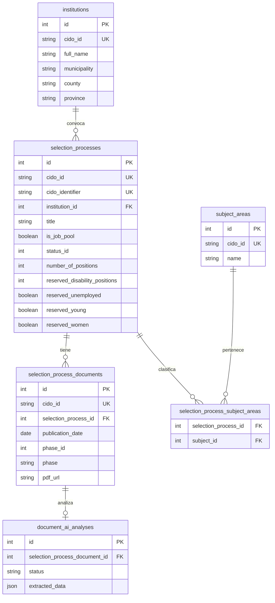

# Convoca'm — SPEC-001: Modelo de datos para integración con CIDO

**Estado:** Propuesta de diseño previa a implementación  
**Versión:** 1.1  
**Fecha:** 2026-09-29  
**Objetivo:** Definir qué datos de CIDO debe conservar Convoca'm, cómo organizarlos en PostgreSQL y qué tablas necesitamos antes de continuar escribiendo código.

---

## Cambios de la versión 1.1

Se revisa la nomenclatura de tablas para que sea más descriptiva y esté más ligada al dominio del proyecto:

| Nombre anterior | Nuevo nombre |
|---|---|
| `public_calls` | `selection_processes` |
| `public_call_documents` | `selection_process_documents` |
| `subjects` | `subject_areas` |
| `public_call_subjects` | `selection_process_subject_areas` |

`institutions` se mantiene porque ya describe correctamente su contenido.

---

## 1. Decisión principal

Convoca'm no consultará CIDO como base de datos principal cada vez que un usuario entre en la aplicación.

El flujo previsto será:

```text
CIDO
  ↓
Sincronización
  ↓
PostgreSQL de Convoca'm
  ↓
Buscador / filtros / perfil del opositor
  ↓
Documentos oficiales
  ↓
Análisis con IA cuando sea necesario
```

CIDO será la **fuente oficial externa** y PostgreSQL será la **base de trabajo de Convoca'm**.

Los PDF no se guardarán permanentemente salvo que en el futuro exista una razón concreta para hacerlo. Guardaremos la URL oficial y, cuando sea necesario, descargaremos el documento temporalmente para analizarlo con IA.

---

## 2. Cómo estructura CIDO los datos

CIDO utiliza JSON:API y mantiene una estructura relacional.

Para procesos selectivos, la entidad principal es:

```text
oposicions
```

Una oposición/convocatoria se relaciona con:

```text
oposicions
├── institucio
├── documents
├── materies
├── institucions-vinculades
├── materies-vinculades
└── ods
```

Para Convoca'm las relaciones prioritarias serán inicialmente:

1. `institucio`
2. `documents`
3. `materies`

Las relaciones jerárquicas `institucions-vinculades` y `materies-vinculades` podrán incorporarse posteriormente si mejoran los filtros.

---

# 3. Tablas que debemos crear inicialmente

La propuesta inicial es crear **5 tablas principales** para los datos procedentes de CIDO.

```text
institutions
     │
     └── selection_processes
             │
             ├── selection_process_documents
             │
             └── selection_process_subject_areas
                        │
                        └── subject_areas
```

Tablas:

1. `selection_processes`
2. `institutions`
3. `selection_process_documents`
4. `subject_areas`
5. `selection_process_subject_areas`

Las tablas de análisis con IA se diseñan en este documento, pero **no es necesario crearlas todavía**.

## Criterio de nombres

Se evita el prefijo `public_` porque todo Convoca'm trabaja ya con convocatorias del sector público y no aporta información adicional.

La entidad principal se denomina `selection_processes` porque representa de forma explícita un **proceso selectivo** y cubre tanto plazas como bolsas de trabajo. Los documentos asociados se llaman `selection_process_documents`.

Las `materies` de CIDO se guardarán como `subject_areas`, para diferenciarlas del **temario** que más adelante pueda extraerse de los PDF mediante IA.

---

# 4. Tabla `selection_processes`

Representa una convocatoria/proceso selectivo de CIDO.

## Identificación

| Campo Convoca'm | Campo CIDO | Tipo recomendado | Obligatorio | Motivo |
|---|---|---|---|---|
| `id` | — | Int autoincrement | Sí | ID interno de Convoca'm |
| `cido_id` | `id` | String | Sí, unique | Identificador técnico de CIDO |
| `cido_identifier` | `identificador` | String | Sí, unique | Identificador funcional de la ficha CIDO |
| `file_number` | `expedient` | String? | No | Expediente oficial |
| `public_offer_year` | `anyOpo` | Int? | No | Año de oferta pública |

### Por qué `cido_id` como String

Aunque CIDO lo entrega como un valor numérico, en JSON aparece como texto y usar `String` evita problemas de serialización de `BigInt` entre Prisma, Next.js y JSON.

---

## Información principal

| Campo Convoca'm | Campo CIDO | Tipo recomendado |
|---|---|---|
| `title` | `titol` | String |
| `is_job_pool` | `borsaTreball` | Boolean |
| `scope_id` | `idAmbit` | Int |
| `scope_name` | `ambit` | String |
| `institution_id` | relación `institucio` | FK nullable inicialmente |
| `institution_name` | `institucioDesenvolupat` | String |

Se conserva `institution_name` aunque exista una relación con `institutions` porque forma parte de la respuesta principal de CIDO y permite mantener una copia del valor original recibido.

---

## Plazos

| Campo Convoca'm | Campo CIDO | Tipo recomendado |
|---|---|---|
| `application_start_date` | `dataInici` | DateTime? |
| `application_end_date` | `dataFinalitzacio` | DateTime? |
| `application_end_time` | `horaFinalitzacio` | String? |
| `application_deadline_notes` | `observacionsTermini` | Text? |

La fecha y la hora se mantienen separadas porque CIDO las proporciona de forma independiente y no debemos inventar zona horaria ni una combinación que la fuente no haya proporcionado.

---

## Sistema de selección y personal

| Campo Convoca'm | Campo CIDO | Tipo recomendado |
|---|---|---|
| `selection_system_id` | `idSistemaSeleccio` | Int? |
| `selection_system` | `sistemaSeleccio` | String? |
| `personnel_type_id` | `idTipusPersonal` | Int? |
| `personnel_type` | `tipusPersonal` | String? |
| `qualification_group_id` | `idGrupTitulacio` | Int? |
| `qualification_group` | `grupTitulacio` | String? |

Ejemplos de grupos que CIDO identifica: A1, A2, C1, C2, agrupaciones profesionales, A1/A2 y Grupo B.

---

## Requisitos

| Campo Convoca'm | Campo CIDO | Tipo recomendado |
|---|---|---|
| `required_qualification` | `titulacioRequerida` | Text? |
| `other_requirements` | `altresRequisits` | Text? |

`other_requirements` puede contener datos importantes como nivel de catalán, carnet de conducir u otros requisitos.

---

## Plazas y reservas

Estos campos son **prioritarios para Convoca'm** porque permiten personalizar y filtrar convocatorias según el perfil de la persona.

| Campo Convoca'm | Campo CIDO | Tipo recomendado |
|---|---|---|
| `number_of_positions` | `numPlaces` | Int? |
| `reserved_disability_positions` | `placesReservadesDiscapacitat` | Int? |
| `reserved_unemployed` | `placesReservadesAtur` | Boolean |
| `reserved_young` | `placesReservadesJoves` | Boolean |
| `reserved_women` | `placesReservadesDones` | Boolean |

Estos datos permitirán filtros como:

```text
☐ Plazas reservadas para personas con discapacidad
☐ Plazas reservadas para personas desempleadas
☐ Plazas reservadas para jóvenes
☐ Plazas reservadas para mujeres
```

Este bloque es una de las funcionalidades diferenciales de Convoca'm.

---

## Prueba y observaciones

| Campo Convoca'm | Campo CIDO | Tipo recomendado |
|---|---|---|
| `first_exam_date` | `dataProva` | DateTime? |
| `observations` | `observacions` | Text? |

---

## Enlaces

| Campo Convoca'm | Campo CIDO | Tipo recomendado |
|---|---|---|
| `institution_url` | `urlWeb` | Text? |
| `application_url` | `accesTramit` | Text? |
| `cido_url` | `urlCido` | Text |

No es necesario guardar `urlSubscripcio`, porque Convoca'm tendrá su propio sistema para guardar y seguir convocatorias.

Tampoco es necesario guardar `urlGoogleMaps`; puede generarse a partir de las coordenadas o usarse la información de la institución.

---

## Estado

| Campo Convoca'm | Campo CIDO | Tipo recomendado |
|---|---|---|
| `status_id` | `idEstat` | Int |
| `status` | `estat` | String |

Estados CIDO:

```text
1 → Pendent de convocatòria
2 → Pendent de termini
3 → Termini obert
4 → Termini tancat
5 → Procés no vigent
6 → Resolt
```

Para la sincronización inicial priorizaremos 1, 2 y 3. Más adelante podremos conservar 4 y 6 para seguimiento histórico del usuario.

---

## Control de sincronización

Campos propios de Convoca'm, no procedentes directamente de CIDO:

| Campo | Tipo recomendado | Uso |
|---|---|---|
| `source_synced_at` | DateTime | Última vez que consultamos este registro en CIDO |
| `source_hash` | String? | Detectar si el contenido recibido ha cambiado |
| `created_at` | DateTime | Creación en Convoca'm |
| `updated_at` | DateTime | Última actualización local |

También conservaremos:

| Campo | CIDO |
|---|---|
| `last_document_publication_date` | `maxDataPublicacioDocument` |

Este valor puede ayudarnos a detectar convocatorias que tengan nuevas publicaciones/documentos.

---

# 5. Tabla `institutions`

La relación `institucio` es importante porque aporta información territorial que no aparece completa en el registro principal de `oposicions`.

## Campos

| Campo Convoca'm | Campo CIDO |
|---|---|
| `id` | ID interno |
| `cido_id` | `id` |
| `full_name` | `institucioDesenvolupat` |
| `short_name` | `institucioAbreujat` |
| `active` | `institucioActiva` |
| `latitude` | `latitud` |
| `longitude` | `longitud` |
| `ine_code` | `codiIne` |
| `address` | `adreca` |
| `postal_code` | `codiPostal` |
| `municipality` | `municipi` |
| `county_code` | `codiComarca` |
| `county` | `comarca` |
| `province_code` | `codiProvincia` |
| `province` | `provincia` |
| `contractor_profile_url` | `urlPerfilContractant` |
| `soc_code` | `soc` |
| `sepe_code` | `sepe` |
| `created_at` | Convoca'm |
| `updated_at` | Convoca'm |

## Decisión importante

Los códigos INE, códigos postales y códigos similares se almacenarán preferentemente como `String`, aunque la API los describa como numéricos, para evitar perder ceros iniciales.

## Por qué necesitamos esta tabla

Permitirá filtros y personalización por:

```text
municipio
comarca
provincia
institución
```

Esto será importante para comparar las convocatorias con las preferencias territoriales del usuario.

---

# 6. Tabla `selection_process_documents`

Cada convocatoria puede tener múltiples documentos/fases.

Ejemplos que CIDO identifica:

```text
Oferta pública
Bases generales
Bases específicas
Convocatoria
Temario
Lista de admitidos y excluidos
Tribunal
Fecha de la prueba
Resultados
Resolución de la convocatoria
Correcciones
Ampliaciones de plazo
```

## Campos

| Campo Convoca'm | Campo CIDO |
|---|---|
| `id` | ID interno |
| `cido_id` | `id` |
| `selection_process_id` | FK a `selection_processes` |
| `publication_date` | `dataPublicacio` |
| `summary` | `resum` |
| `publisher` | `anunciant` |
| `bulletin_id` | `idButlleti` |
| `bulletin` | `butlleti` |
| `bulletin_number` | `numButlleti` |
| `source_catalogued_at` | `dataEntrada` |
| `phase_id` | `idFase` |
| `phase` | `fase` |
| `phase_notes` | `observacionsFase` |
| `pdf_url` | `urlPdf` |
| `html_url` | `urlHtml` |
| `source_synced_at` | Convoca'm |
| `created_at` | Convoca'm |
| `updated_at` | Convoca'm |

## Decisión sobre los PDF

No almacenaremos inicialmente el archivo PDF.

Guardaremos:

```text
pdf_url
```

Cuando Convoca'm necesite analizar un documento:

```text
pdf_url
  ↓
descarga temporal
  ↓
extracción de texto
  ↓
análisis IA
  ↓
resultado estructurado en PostgreSQL
```

---

# 7. Tabla `subject_areas`

Representa las materias clasificadas por CIDO.

## Campos

| Campo Convoca'm | Campo CIDO |
|---|---|
| `id` | ID interno |
| `cido_id` | `id` |
| `name` | `materia` |
| `module_id` | `idModul` |

Para oposiciones, `idModul = 4` corresponde al módulo Oposicions.

---

# 8. Tabla `selection_process_subject_areas`

Una convocatoria puede estar asociada a varias materias y una materia puede aparecer en muchas convocatorias.

Por eso necesitamos una tabla intermedia:

```text
selection_process_subject_areas
```

Campos:

```text
selection_process_id
subject_id
```

Clave única compuesta:

```text
(selection_process_id, subject_id)
```

---

# 9. Diseño para IA — NO crear todavía

La IA será una segunda fase.

No conviene añadir desde ahora decenas de columnas a `selection_processes` para información que todavía no sabemos exactamente cómo extraer.

La propuesta inicial es una tabla:

```text
document_ai_analyses
```

## Campos previstos

```text
id
selection_process_document_id
status
model
extraction_version
source_hash
extracted_data JSONB
source_references JSONB
analyzed_at
error_message
created_at
updated_at
```

`extracted_data` podría contener:

```json
{
  "applicationFee": {
    "amount": 32.15,
    "currency": "EUR",
    "exemptions": []
  },
  "syllabus": {
    "topicsCount": 40,
    "topics": []
  },
  "tests": [],
  "requirements": [],
  "requiredDocuments": [],
  "deadlines": []
}
```

## Trazabilidad

La IA no debe guardar solamente una respuesta sin origen.

Cuando sea posible, cada dato importante debe conservar referencia al documento original y, si técnicamente es viable, a la página o fragmento del que se extrajo.

Esto es especialmente importante para:

```text
tasas
plazos
requisitos
temarios
fechas de examen
documentación obligatoria
```

Convoca'm deberá dejar claro que es información extraída automáticamente y mantener siempre accesible el documento oficial.

---

# 10. Posible tabla futura `cido_sync_runs`

No es imprescindible para empezar, pero será recomendable cuando automaticemos la sincronización.

Permitirá saber cuándo se ejecutó una sincronización y qué ocurrió.

Campos previstos:

```text
id
started_at
finished_at
status
records_received
records_created
records_updated
records_failed
error_message
```

---

# 11. Diagrama simplificado



---

# 12. Qué NO debemos hacer

## No copiar las 772.000 convocatorias históricas de golpe

La sincronización inicial debe centrarse en procesos relevantes y después definir una estrategia histórica si realmente la necesitamos.

## No consultar CIDO desde la interfaz para cada búsqueda del usuario

El buscador trabajará sobre PostgreSQL.

## No guardar los PDF por defecto

Guardaremos la URL oficial y procesaremos temporalmente el archivo cuando sea necesario.

## No mezclar datos CIDO con datos extraídos por IA

Debe quedar clara la diferencia entre:

```text
Dato oficial de CIDO
```

y

```text
Dato interpretado/extraído por Convoca'm
```

---

# 13. Tablas propuestas por fase

## Crear antes de continuar con la integración

```text
selection_processes
institutions
selection_process_documents
subject_areas
selection_process_subject_areas
```

## Crear más adelante

```text
document_ai_analyses
cido_sync_runs
```

Podrían aparecer nuevas tablas cuando definamos el seguimiento personal del opositor, pero no forman parte de la integración básica con CIDO.

---

# 14. Próximo paso recomendado

Antes de crear ningún cliente HTTP ni escribir la sincronización:

1. Revisar y aprobar este modelo.
2. Decidir nombres definitivos de tablas y campos.
3. Traducir este diseño a modelos Prisma.
4. Crear migración.
5. Implementar repositorios/casos de uso siguiendo Clean Architecture.
6. Después implementar el cliente CIDO y la sincronización.

Por tanto, el siguiente paso técnico no debería ser todavía `cido-client.ts`.

Debe ser:

```text
PASO 27.4
Diseñar y aprobar el esquema Prisma de convocatorias CIDO
```

---

# 15. Fuentes oficiales utilizadas

- Portal de documentación técnica de la API CIDO:  
  https://dadesobertes.diba.cat/dades-obertes/documentacio-tecnica/api-cido

- Estructura de la base de datos CIDO:  
  https://dadesobertes.diba.cat/dades-obertes/documentacio-tecnica/api-cido/estructura-base-dades

- Estructura de los datos CIDO:  
  https://dadesobertes.diba.cat/dades-obertes/documentacio-tecnica/api-cido/estructura-dades

- Dataset CIDO — Processos selectius:  
  https://dadesobertes.diba.cat/datasets/cido-processos-selectius

- Documentación técnica PDF de la API CIDO:  
  https://dadesobertes.diba.cat/sites/default/files/public/cido_jsonapi_web_diba.pdf

